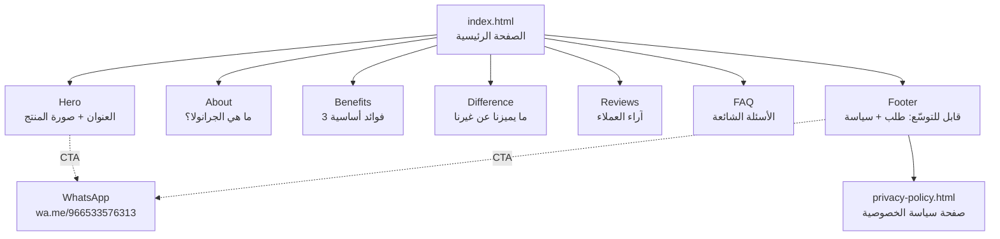
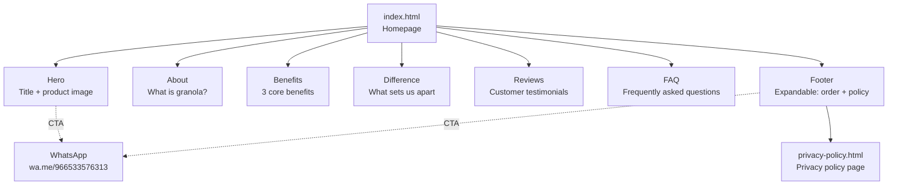

<div align="center">

# 🌾 أورلا | Orla Granola

### جرانولا كما يفترض أن تكون · Granola, the way it should be

### 🌐 اختر اللغة · Choose Language

**[🇸🇦 العربية](#-النسخة-العربية)** &nbsp;•&nbsp; **[🇬🇧 English](#-english-version)**

[](#-تحسين-محركات-البحث-seo)
[](#-الأداء-performance)
[](#-إمكانية-الوصول-accessibility)
[](#-النسخة-العربية)

</div>

---

<a name="-النسخة-العربية"></a>

# 🇸🇦 النسخة العربية

<div align="left">

[⬆️ Switch to English](#-english-version)

</div>

<div dir="rtl">

متجر رقمي تعريفي لعلامة **أورلا** للجرانولا الصحية، مبني كصفحة هبوط (Landing Page) سريعة ومتجاوبة وموجّهة بالكامل للتحويل. يعرض الموقع قصة العلامة، وفوائد الجرانولا، ومميزات المنتج، وآراء العملاء، والأسئلة الشائعة — وصولاً إلى دعوة واضحة للطلب عبر واتساب. الموقع مصمم بمنهجية **Mobile-First**، وبأسلوب بصري يعكس دفء المنتج الطبيعي وشفافيته، مع التركيز على تجربة استخدام سلسة وأداء عالٍ.

</div>

---

<div dir="rtl">

## 📋 جدول المحتويات

- [نظرة عامة](#-نظرة-عامة)
- [مبادئ التصميم الأساسية](#-مبادئ-التصميم-الأساسية)
- [المزايا الرئيسية](#-المزايا-الرئيسية)
- [التقنيات المستخدمة](#-التقنيات-المستخدمة)
- [هيكل الموقع](#-هيكل-الموقع)
- [هوية العلامة البصرية](#-هوية-العلامة-البصرية)
- [تحسين محركات البحث (SEO)](#-تحسين-محركات-البحث-seo)
- [البيانات المنظّمة (Structured Data)](#-البيانات-المنظّمة-structured-data)
- [الأداء (Performance)](#-الأداء-performance)
- [إمكانية الوصول (Accessibility)](#-إمكانية-الوصول-accessibility)
- [بنية المشروع](#-بنية-المشروع)
- [دليل التشغيل المحلي](#-دليل-التشغيل-المحلي)
- [النشر (Deployment)](#-النشر-deployment)
- [قائمة التحقق قبل الإطلاق](#-قائمة-التحقق-قبل-الإطلاق)

</div>

---

<div dir="rtl">

## 🎯 نظرة عامة

**أورلا** منصّة تعريفيّة أحاديّة الصفحة (Single-Page Landing) صُممت لتحويل الزائر إلى عميل بأقل عدد ممكن من النقرات. بدل التصفّح الطويل داخل متجر إلكتروني معقّد، يكفي الزائر أن يتصفح الصفحة الرئيسية، يتعرّف على المنتج، يقرأ آراء العملاء، ثم ينقر زر **"اطلب الآن"** ليُحوَّل مباشرةً إلى محادثة واتساب مع فريق البيع.

الموقع موجّه للسوق السعودي بشكل أساسي، وهو **ثنائي اللغة بصرياً** (العربية هي اللغة الأم) مع دعم كامل لاتجاه RTL، وخط عربي أنيق (Markazi Text) يمنح النص طابعاً تقليدياً دافئاً يتناسب مع طبيعة المنتج.

</div>

---

<div dir="rtl">

## 🧭 مبادئ التصميم الأساسية

| المبدأ | الوصف |
|--------|-------|
| **التحويل قبل كل شيء** | كل قسم في الصفحة يخدم هدفاً واحداً: دفع الزائر نحو زر الطلب |
| **وضوح فوري (Above the Fold)** | العنوان، الوصف، وصورة المنتج تظهر في الشاشة الأولى بلا تمرير |
| **الدفء الطبيعي** | لوحة ألوان ترابية (بيج، بنّي، عسلي) تعكس المنتج الطبيعي |
| **الحركة الهادفة** | تأثيرات `reveal` عند التمرير وتأثير `float` للعلبة تُضفي حيوية دون تشتيت |
| **Mobile-First** | التصميم يبدأ من الجوال (640px) ثم يتوسّع للشاشات الأكبر |
| **بدون صور ثقيلة** | WebP فقط، مع `srcset` و`preload` لأهم صورة (LCP) |
| **صفر مكتبات خارجية** | لا React، لا Vue، لا Tailwind CDN — HTML/CSS/JS خام فقط |

</div>

---

<div dir="rtl">

## ✨ المزايا الرئيسية

- 🎨 **تصميم مخصّص بالكامل** — لا قوالب جاهزة، كل تفصيل مبني يدوياً
- 🌐 **دعم RTL كامل** — `<html dir="rtl">` مع ضبط دقيق للتخطيط والخطوط
- 🖼️ **صور محسّنة** — WebP متعدد المقاسات مع `srcset` + `sizes`
- 🔗 **طلب مباشر عبر واتساب** — بدون سلة، بدون تسجيل، بدون تعقيد
- ⭐ **قسم آراء متحرك** — Carousel تلقائي لعرضين مع انتقالات سلسة
- ❓ **أسئلة شائعة تفاعلية** — Accordion مع ARIA صحيح
- 📜 **سياسة خصوصية منفصلة** — صفحة كاملة `privacy-policy.html`
- 🔍 **تحسين SEO متقدّم** — Meta كاملة + Schema.org + Open Graph
- 📊 **Google Analytics 4** — تتبّع الزيارات والتحويلات
- ♿ **إمكانية وصول** — ARIA, Focus states, `prefers-reduced-motion`
- 🚀 **أداء عالٍ** — LCP مُحسّن، خطوط lazy، بدون blocking scripts
- 📱 **متجاوب حتى 320px** — دعم شاشات الجوال الصغيرة

</div>

---

## 🛠 التقنيات المستخدمة

<div dir="rtl">

### المكدّس الأساسي

</div>

| التقنية | الإصدار | الاستخدام |
|---------|---------|-----------|
| HTML5 | — | البنية الدلالية (Semantic HTML) |
| CSS3 | — | التنسيق، Animations، Grid & Flexbox |
| Vanilla JavaScript | ES2020+ | التفاعل (Menu, FAQ, Carousel, Reveal) |
| WebP | — | صيغة الصور الأساسية |
| SVG Inline | — | أيقونات + ضجيج خفيف (Noise texture) |
| Google Fonts | — | خط Markazi Text العربي |

### الأدوات والخدمات

| الأداة | الاستخدام |
|--------|-----------|
| Google Analytics 4 | تحليلات الزيارات والتحويلات |
| WhatsApp Business API | استقبال الطلبات |
| Schema.org (JSON-LD) | البيانات المنظّمة لمحركات البحث |
| IntersectionObserver API | تأثيرات الظهور عند التمرير |

</div>

---

<div dir="rtl">

## 🗺 هيكل الموقع

الموقع يتكوّن من صفحتين أساسيتين فقط، مع تركيز كامل على البساطة:

</div>



<div dir="rtl">

| # | القسم | الوصف |
|---|-------|-------|
| 1 | **Hero** | العنوان الرئيسي + صورة العلبة المتحركة + دعوة للطلب |
| 2 | **About** | تعريف الجرانولا وقيمتها الغذائية |
| 3 | **Benefits** | ثلاث فوائد معروضة ببطاقات مرقّمة |
| 4 | **Difference** | نقاط التميّز (طبيعي، طازج، شفاف) |
| 5 | **Reviews** | كاروسيل آراء متحرّك تلقائياً |
| 6 | **FAQ** | أربعة أسئلة شائعة بنظام Accordion |
| 7 | **Footer** | لوحة قابلة للتوسّع تحتوي زر الطلب + روابط التواصل |

</div>

---

<div dir="rtl">

## 🎨 هوية العلامة البصرية

### لوحة الألوان

| المتغيّر | القيمة | الاستخدام |
|----------|--------|-----------|
| `--bg` | `#F7E9CE` | خلفية الصفحة الرئيسية (بيج دافئ) |
| `--ink` | `#584827` | النص الأساسي والعناصر المميزة (بنّي ترابي) |
| `--ink-soft` | `rgba(88,72,39,.72)` | النص الثانوي |
| `--paper` | `#F3DFC0` | خلفية القوائم والبطاقات |
| `--paper-deep` | `#EBD0A9` | تدرّجات أغمق |
| `--footer-bg` | `#574727` | خلفية التذييل |
| `--footer-ink` | `#F4E8CD` | نص التذييل |

### الخطوط

- **Markazi Text** — خط عربي تقليدي، أوزان من 400 إلى 700، يُحمَّل بشكل غير معطّل (`rel="preload"` + `onload`)

### الأنماط البصرية المميزة

- حلقات ديكورية ثابتة في الزوايا العلوية والسفلية للصفحة
- طبقة `noise` خفيفة جداً (Opacity 5.5%) تُضفي طابعاً ورقياً طبيعياً
- بطاقات بحدود يمينية سميكة (Border-right) بدل الحدود الكاملة
- زوايا غير متناظرة (`border-radius: 1.25rem 0 1.25rem 0`) تُعطي إحساساً يدوياً

</div>

---

<div dir="rtl">

## 🔍 تحسين محركات البحث (SEO)

### على الصفحة الرئيسية

- ✅ `<title>` فريد وواضح (بدون مسافات زائدة)
- ✅ `<meta name="description">` مقنعة بطول مناسب (150–160 حرفاً)
- ✅ `<link rel="canonical">` لمنع تكرار المحتوى
- ✅ `meta name="robots"` مع `index, follow, max-image-preview:large`
- ✅ `meta name="theme-color"` لدعم PWA وشريط المتصفح
- ✅ `lang="ar"` و `dir="rtl"` على مستوى `<html>`
- ✅ هيكل عناوين سليم: H1 واحد فقط، ثم H2 للأقسام، H3 داخلها
- ✅ Alt text وصفي لكل صورة
- ✅ Semantic HTML: `<nav>`, `<main>`, `<header>`, `<section>`, `<footer>`

### Open Graph & Twitter Cards

```
og:type · og:locale · og:site_name · og:title
og:description · og:url · og:image (1200×630)
og:image:width · og:image:height · og:image:alt
twitter:card · twitter:title · twitter:description · twitter:image
```

### على صفحة سياسة الخصوصية

- ✅ Canonical مستقل
- ✅ Meta description مخصّصة
- ✅ Open Graph كامل
- ✅ BreadcrumbList Schema

### الملفات المساعدة

| الملف | الوصف |
|-------|-------|
| `robots.txt` | يوجّه عناكب البحث ويشير إلى Sitemap |
| `sitemap.xml` | يشمل الصفحتين الأساسيتين مع صورهما |
| `site.webmanifest` | دعم PWA وأيقونات الجوال |

</div>

---

<div dir="rtl">

## 📊 البيانات المنظّمة (Structured Data)

يستخدم الموقع **JSON-LD** بصيغة `@graph` لربط عدة أنواع من البيانات في كتلة واحدة:

| النوع | الوصف |
|-------|-------|
| `Organization` | معلومات العلامة، الشعار، جهة الاتصال، حسابات التواصل الاجتماعي |
| `WebSite` | معلومات الموقع وعلاقته بالمنظمة |
| `Product` | تفاصيل المنتج (الاسم، الوصف، الوزن، العلامة، حالة التوفّر) |
| `AggregateRating` | متوسط التقييم الإجمالي |
| `Review` | آراء العملاء الموثّقة |
| `FAQPage` | جميع الأسئلة الشائعة مع إجاباتها |
| `BreadcrumbList` | مسار التنقّل داخل الموقع |

> هذا التوليف يُتيح للموقع الظهور في **نتائج البحث الغنية** (Rich Results) مثل: نجوم التقييم، الأسعار، الأسئلة الشائعة المنسدلة، وروابط Sitelinks.

</div>

---

<div dir="rtl">

## ⚡ الأداء (Performance)

تم تحسين الأداء من عدة جوانب لتحقيق **Core Web Vitals** مرتفعة:

### تحسين الصور (LCP)

- صيغة **WebP** لجميع الصور (حجم أصغر بـ 25–35% من JPEG)
- استخدام `srcset` + `sizes` لتقديم المقاس المناسب لكل شاشة
- `preload` مع `fetchpriority="high"` لصورة البطل (Hero Image)
- `loading="lazy"` + `decoding="async"` للصور أقل أهمية

### تحسين الخطوط

- `preconnect` لخوادم Google Fonts
- تحميل غير معطّل (Non-blocking) عبر `onload` + `noscript` fallback
- `display=swap` لعرض النص فوراً قبل وصول الخط

### تحسين JavaScript

- **Vanilla JS فقط** — بدون مكتبات ثقيلة
- كل السكربتات في نهاية `<body>` (لا تعطّل العرض)
- `IntersectionObserver` بدل مستمعات التمرير التقليدية
- احترام `prefers-reduced-motion` لتعطيل الحركات عند الطلب

### تحسين CSS

- ملف CSS واحد مضمّن داخل `<head>` (لا طلبات شبكة إضافية)
- Utility classes يدوية (بدون Tailwind)
- استخدام CSS Custom Properties (Variables) لسهولة التعديل

</div>

---

<div dir="rtl">

## ♿ إمكانية الوصول (Accessibility)

| الميزة | التطبيق |
|--------|---------|
| **Semantic HTML** | استخدام الوسوم الدلالية بدل `<div>` العمياء |
| **Focus Visible** | حلقة تركيز واضحة (`outline: 2px solid`) لكل عنصر تفاعلي |
| **ARIA Labels** | على القوائم والأزرار (مثل `aria-label="القائمة الرئيسية"`) |
| **ARIA States** | `aria-expanded`, `aria-hidden`, `aria-controls`, `aria-labelledby` |
| **Keyboard Navigation** | التنقل الكامل بلوحة المفاتيح في FAQ والقائمة |
| **Reduced Motion** | احترام تفضيل المستخدم لإيقاف الحركات |
| **Contrast Ratio** | نسبة تباين النص مع الخلفية تتوافق مع WCAG AA |
| **Screen Reader Friendly** | نصوص بديلة وصفية لكل الصور الأيقونية |
| **RTL Native** | دعم فطري للعربية دون قلب يدوي للتخطيط |

</div>

---

<div dir="rtl">

## 📂 بنية المشروع

</div>

```
orla-granola/
├── index.html                    # الصفحة الرئيسية
├── privacy-policy.html           # صفحة سياسة الخصوصية
├── robots.txt                    # توجيهات عناكب البحث
├── sitemap.xml                   # خريطة الموقع
├── site.webmanifest              # ملف PWA
├── favicon.ico                   # أيقونة الموقع الأساسية
└── assets/
    ├── logo.webp                 # شعار أورلا
    ├── jar-240.webp              # صورة العلبة — مقاس صغير
    ├── jar-360.webp              # صورة العلبة — مقاس متوسط
    ├── jar-480.webp              # صورة العلبة — مقاس كبير
    ├── og-cover.jpg              # صورة Open Graph (1200×630)
    ├── imgfl.webp                # شعار منصة العمل الحر
    ├── instagram.webp            # أيقونة إنستغرام
    ├── tiktok.webp               # أيقونة تيك توك
    ├── whatsapp.webp             # أيقونة واتساب
    └── icons/                    # أيقونات PWA
        ├── favicon-16x16.png
        ├── favicon-32x32.png
        ├── apple-touch-icon.png
        ├── icon-192.png
        └── icon-512.png
```

<div dir="rtl">

> **ملاحظة:** المشروع **لا يحتوي على أي عملية بناء (Build Step)** — الملفات جاهزة للنشر مباشرة.

</div>

---

<div dir="rtl">

## 🚀 دليل التشغيل المحلي

### الطريقة 1: سيرفر Python (موصى به للاختبار السريع)

</div>

```bash
# من داخل مجلد المشروع
python -m http.server 8000
# أو
python3 -m http.server 8000
```

ثم افتح: `http://localhost:8000`

<div dir="rtl">

### الطريقة 2: سيرفر Node.js

</div>

```bash
npx serve .
# أو
npx http-server -p 8000
```

<div dir="rtl">

### الطريقة 3: Live Server (VS Code)

ثبّت إضافة **Live Server** ثم اضغط بزر الفأرة الأيمن على `index.html` ← اختر **"Open with Live Server"**.

> ⚠️ **تحذير:** لا تفتح الملف مباشرة عبر `file://` — بعض المزايا (مثل الأيقونات، Sitemap، Schema) تحتاج سيرفراً حقيقياً لتعمل بشكل صحيح.

</div>

---

<div dir="rtl">

## 🌐 النشر (Deployment)

المشروع **ملفّات ثابتة بحتة**، لذا يمكن نشره على أي من المنصات التالية بدون أي إعداد:

| المنصة | ملاحظات |
|--------|---------|
| **Vercel** | اربط المستودع وانشر مباشرةً (بدون Build Command) |
| **Netlify** | اسحب المجلد إلى الواجهة وانشر |
| **Cloudflare Pages** | نشر فوري مع شبكة CDN عالمية |
| **GitHub Pages** | من إعدادات المستودع ← Pages ← اختر الفرع |
| **Netlify Drop** | [app.netlify.com/drop](https://app.netlify.com/drop) — اسحب المجلد فقط |
| **أي استضافة مشتركة** | ارفع الملفات عبر FTP إلى `public_html` |

### بعد النشر — قائمة تحقق

1. ✅ ربط الدومين الحقيقي `orla-granola.sa`
2. ✅ تفعيل HTTPS (Let's Encrypt أو Cloudflare)
3. ✅ إرسال `sitemap.xml` إلى Google Search Console
4. ✅ اختبار Open Graph عبر [opengraph.xyz](https://www.opengraph.xyz)
5. ✅ اختبار Schema عبر [Rich Results Test](https://search.google.com/test/rich-results)
6. ✅ قياس الأداء عبر [PageSpeed Insights](https://pagespeed.web.dev)
7. ✅ التأكد من ظهور الأيقونة في التبويب (Favicon Checker)

</div>

---

<div dir="rtl">

## ✅ قائمة التحقق قبل الإطلاق

### المحتوى والتصميم

- [ ] مراجعة جميع النصوص إملائياً ونحوياً
- [ ] التأكد من وضوح صور المنتج في كل المقاسات
- [ ] اختبار التصميم على الأجهزة: iPhone SE, iPhone 14, Galaxy, iPad, Desktop
- [ ] اختبار الوضع الليلي (إن أُضيف مستقبلاً)

### الوظائف

- [ ] اختبار زر الطلب عبر واتساب على الجوال والحاسوب
- [ ] اختبار جميع روابط التواصل الاجتماعي
- [ ] اختبار Accordion الأسئلة الشائعة
- [ ] اختبار Carousel الآراء
- [ ] اختبار زر توسيع التذييل (Footer)

### التقنية

- [ ] توليد `favicon.ico` ورفعه في الجذر
- [ ] توليد أيقونات PWA بمقاسات متعددة
- [ ] التأكد من رفع `robots.txt` و `sitemap.xml`
- [ ] تفعيل Google Analytics 4 ورصد أول زيارة
- [ ] اختبار الأداء على PageSpeed (الهدف: 95+)
- [ ] اختبار Schema على Rich Results Test

### الأمان والخصوصية

- [ ] إضافة `rel="noopener noreferrer"` لكل الروابط الخارجية
- [ ] التأكد من صحة سياسة الخصوصية
- [ ] تفعيل شهادة SSL على الدومين
- [ ] إعداد ترويسات الأمان (Security Headers)

</div>

---

<div dir="rtl">

## 📞 التواصل والطلب

| القناة | الرابط |
|--------|--------|
| **واتساب (الطلب)** | [+966533576313](https://wa.me/966533576313) |
| **إنستغرام** | [@orla.granola](https://www.instagram.com/orla.granola/) |
| **تيك توك** | [@orla.granola](https://www.tiktok.com/@orla.granola) |
| **الموقع** | [orla-granola.sa](https://orla-granola.sa/) |

</div>

---

<div dir="rtl">

## 📄 الترخيص

جميع الحقوق محفوظة لـ **أورلا** © 2026

هذا المشروع، بجميع ملفاته وأصوله البصرية ونصوصه، ملكية خاصة ولا يجوز إعادة استخدامه أو توزيعه دون إذن كتابي مسبق.

---

<div align="center">

**أورلا — جرانولا كما يفترض أن تكون** 🌾

صُنع بشغف في المملكة العربية السعودية 🇸🇦

</div>

</div>

---

<a name="-english-version"></a>

# 🇬🇧 English Version

[⬆️ التبديل إلى العربية](#-النسخة-العربية)

A digital brand showcase for **Orla** — a healthy granola label. Built as a fast, responsive, conversion-focused landing page. The site presents the brand story, granola benefits, product differentiators, customer reviews, and FAQs — culminating in a clear call to order via WhatsApp. It follows a **Mobile-First** philosophy with a warm, natural visual language that reflects the product's honesty and craft, prioritizing smooth UX and high performance.

## 📋 Table of Contents

- [Overview](#overview)
- [Core Design Principles](#core-design-principles)
- [Key Features](#key-features)
- [Tech Stack](#tech-stack)
- [Site Structure](#site-structure)
- [Brand Visual Identity](#brand-visual-identity)
- [SEO Optimization](#seo-optimization)
- [Structured Data](#structured-data)
- [Performance](#performance)
- [Accessibility](#accessibility)
- [Project Structure](#project-structure)
- [Local Development](#local-development)
- [Deployment](#deployment)
- [Pre-Launch Checklist](#pre-launch-checklist)

---

## Overview

**Orla** is a single-page landing platform designed to convert visitors into customers with the fewest possible clicks. Instead of navigating a complex e-commerce site, visitors browse the homepage, learn about the product, read customer reviews, then click **"Order Now"** to be redirected directly to a WhatsApp conversation with the sales team.

The site primarily targets the Saudi market, is **visually bilingual** (Arabic-first), with full RTL support and an elegant Arabic typeface (Markazi Text) that lends the text a warm, traditional character befitting the product's nature.

---

## Core Design Principles

| Principle | Description |
|-----------|-------------|
| **Conversion-First** | Every section serves one goal: pushing the visitor toward the order button |
| **Instant Clarity (Above the Fold)** | Title, description, and product image appear in the first viewport without scrolling |
| **Natural Warmth** | Earthy palette (beige, brown, honey) reflecting the natural product |
| **Purposeful Motion** | Scroll-triggered `reveal` effects and a `float` animation on the jar add life without distraction |
| **Mobile-First** | Design starts at mobile (640px) then scales up |
| **Zero Heavy Images** | WebP only, with `srcset` and `preload` for the LCP image |
| **Zero External Libraries** | No React, no Vue, no Tailwind CDN — raw HTML/CSS/JS only |

---

## Key Features

- 🎨 **Fully bespoke design** — no templates, every detail handcrafted
- 🌐 **Full RTL support** — `<html dir="rtl">` with meticulous layout and typography tuning
- 🖼️ **Optimized images** — multi-size WebP with `srcset` + `sizes`
- 🔗 **Direct WhatsApp ordering** — no cart, no sign-up, no friction
- ⭐ **Animated reviews section** — auto-rotating carousel for two testimonials
- ❓ **Interactive FAQ** — Accordion with proper ARIA
- 📜 **Separate privacy policy** — full `privacy-policy.html` page
- 🔍 **Advanced SEO** — complete meta + Schema.org + Open Graph
- 📊 **Google Analytics 4** — traffic and conversion tracking
- ♿ **Accessibility** — ARIA, focus states, `prefers-reduced-motion`
- 🚀 **High performance** — optimized LCP, lazy fonts, no blocking scripts
- 📱 **Responsive down to 320px** — support for small mobile screens

---

## Tech Stack

### Core Stack

| Technology | Version | Purpose |
|------------|---------|---------|
| HTML5 | — | Semantic structure |
| CSS3 | — | Styling, animations, Grid & Flexbox |
| Vanilla JavaScript | ES2020+ | Interactivity (menu, FAQ, carousel, reveal) |
| WebP | — | Primary image format |
| Inline SVG | — | Icons + subtle noise texture |
| Google Fonts | — | Markazi Text Arabic typeface |

### Tools & Services

| Tool | Purpose |
|------|---------|
| Google Analytics 4 | Traffic & conversion analytics |
| WhatsApp Business API | Order intake |
| Schema.org (JSON-LD) | Search engine structured data |
| IntersectionObserver API | Scroll reveal effects |

---

## Site Structure

The site consists of just two primary pages, with a full focus on simplicity:



| # | Section | Description |
|---|---------|-------------|
| 1 | **Hero** | Main headline + animated jar image + order CTA |
| 2 | **About** | Granola definition and nutritional value |
| 3 | **Benefits** | Three benefits shown as numbered cards |
| 4 | **Difference** | Points of differentiation (natural, fresh, transparent) |
| 5 | **Reviews** | Auto-rotating review carousel |
| 6 | **FAQ** | Four FAQs in an Accordion layout |
| 7 | **Footer** | Expandable panel with order button + social links |

---

## Brand Visual Identity

### Color Palette

| Variable | Value | Usage |
|----------|-------|-------|
| `--bg` | `#F7E9CE` | Page background (warm beige) |
| `--ink` | `#584827` | Primary text and accents (earthy brown) |
| `--ink-soft` | `rgba(88,72,39,.72)` | Secondary text |
| `--paper` | `#F3DFC0` | Menus and cards background |
| `--paper-deep` | `#EBD0A9` | Deeper gradients |
| `--footer-bg` | `#574727` | Footer background |
| `--footer-ink` | `#F4E8CD` | Footer text |

### Typography

- **Markazi Text** — traditional Arabic typeface, weights 400–700, loaded non-blocking (`rel="preload"` + `onload`)

### Distinctive Visual Details

- Fixed decorative rings in the top and bottom corners
- A very subtle `noise` overlay (5.5% opacity) lending a paper-like, natural feel
- Cards with thick right borders instead of full borders
- Asymmetric corners (`border-radius: 1.25rem 0 1.25rem 0`) for a handmade vibe

---

## SEO Optimization

### Homepage

- ✅ Unique, clear `<title>` (no trailing spaces)
- ✅ Compelling `<meta name="description">` at proper length (150–160 chars)
- ✅ `<link rel="canonical">` to prevent duplicate content
- ✅ `meta name="robots"` with `index, follow, max-image-preview:large`
- ✅ `meta name="theme-color"` for PWA and browser chrome
- ✅ `lang="ar"` and `dir="rtl"` at the `<html>` level
- ✅ Proper heading hierarchy: single H1, H2 per section, H3 within
- ✅ Descriptive alt text on every image
- ✅ Semantic HTML: `<nav>`, `<main>`, `<header>`, `<section>`, `<footer>`

### Open Graph & Twitter Cards

```
og:type · og:locale · og:site_name · og:title
og:description · og:url · og:image (1200×630)
og:image:width · og:image:height · og:image:alt
twitter:card · twitter:title · twitter:description · twitter:image
```

### Privacy Policy Page

- ✅ Independent canonical
- ✅ Dedicated meta description
- ✅ Complete Open Graph
- ✅ BreadcrumbList schema

### Supporting Files

| File | Description |
|------|-------------|
| `robots.txt` | Directs search engine crawlers and points to Sitemap |
| `sitemap.xml` | Includes both pages with their images |
| `site.webmanifest` | PWA support and mobile icons |

---

## Structured Data

The site uses **JSON-LD** in `@graph` format to link multiple data types in one block:

| Type | Description |
|------|-------------|
| `Organization` | Brand info, logo, contact point, social accounts |
| `WebSite` | Site info and its relationship to the organization |
| `Product` | Product details (name, description, weight, brand, availability) |
| `AggregateRating` | Overall aggregate rating |
| `Review` | Documented customer testimonials |
| `FAQPage` | All FAQs with their answers |
| `BreadcrumbList` | Navigation path within the site |

> This combination enables the site to appear in **Rich Results** such as: star ratings, prices, collapsible FAQs, and Sitelinks.

---

## Performance

Performance has been optimized on multiple fronts to achieve high **Core Web Vitals**:

### Image Optimization (LCP)

- **WebP** format for all images (25–35% smaller than JPEG)
- `srcset` + `sizes` to serve the right size for every screen
- `preload` with `fetchpriority="high"` for the Hero image
- `loading="lazy"` + `decoding="async"` for less-critical images

### Font Optimization

- `preconnect` to Google Fonts servers
- Non-blocking load via `onload` + `noscript` fallback
- `display=swap` to render text immediately before the font arrives

### JavaScript Optimization

- **Vanilla JS only** — no heavy libraries
- All scripts at the end of `<body>` (non-blocking)
- `IntersectionObserver` instead of traditional scroll listeners
- Respects `prefers-reduced-motion` to disable animations on request

### CSS Optimization

- A single CSS file inlined within `<head>` (no extra network requests)
- Hand-rolled utility classes (no Tailwind)
- CSS Custom Properties (Variables) for easy theming

---

## Accessibility

| Feature | Implementation |
|---------|----------------|
| **Semantic HTML** | Semantic tags instead of blind `<div>`s |
| **Focus Visible** | Clear focus ring (`outline: 2px solid`) on every interactive element |
| **ARIA Labels** | On menus and buttons (e.g. `aria-label="القائمة الرئيسية"`) |
| **ARIA States** | `aria-expanded`, `aria-hidden`, `aria-controls`, `aria-labelledby` |
| **Keyboard Navigation** | Full keyboard navigation in FAQ and menu |
| **Reduced Motion** | Respects the user's preference to disable animations |
| **Contrast Ratio** | Text-to-background ratio meets WCAG AA |
| **Screen Reader Friendly** | Descriptive alt text on every icon image |
| **RTL Native** | Native Arabic support without manual layout flipping |

---

## Project Structure

```
orla-granola/
├── index.html                    # Homepage
├── privacy-policy.html           # Privacy policy page
├── robots.txt                    # Crawler directives
├── sitemap.xml                   # Site map
├── site.webmanifest              # PWA manifest
├── favicon.ico                   # Primary site icon
└── assets/
    ├── logo.webp                 # Orla logo
    ├── jar-240.webp              # Jar image — small
    ├── jar-360.webp              # Jar image — medium
    ├── jar-480.webp              # Jar image — large
    ├── og-cover.jpg              # Open Graph image (1200×630)
    ├── imgfl.webp                # Freelance platform logo
    ├── instagram.webp            # Instagram icon
    ├── tiktok.webp               # TikTok icon
    ├── whatsapp.webp             # WhatsApp icon
    └── icons/                    # PWA icons
        ├── favicon-16x16.png
        ├── favicon-32x32.png
        ├── apple-touch-icon.png
        ├── icon-192.png
        └── icon-512.png
```

> **Note:** The project has **no build step** — files are ready to deploy as-is.

---

## Local Development

### Option 1: Python server (recommended for quick testing)

```bash
# From inside the project folder
python -m http.server 8000
# or
python3 -m http.server 8000
```

Then open: `http://localhost:8000`

### Option 2: Node.js server

```bash
npx serve .
# or
npx http-server -p 8000
```

### Option 3: Live Server (VS Code)

Install the **Live Server** extension, then right-click `index.html` → choose **"Open with Live Server"**.

> ⚠️ **Warning:** Don't open files directly via `file://` — some features (icons, sitemap, schema) require a real server to work correctly.

---

## Deployment

The project is **purely static files**, so it can be deployed on any of the following platforms with zero configuration:

| Platform | Notes |
|----------|-------|
| **Vercel** | Connect the repo and deploy directly (no build command) |
| **Netlify** | Drag the folder to the interface and deploy |
| **Cloudflare Pages** | Instant deploy with global CDN |
| **GitHub Pages** | Repo settings → Pages → choose branch |
| **Netlify Drop** | [app.netlify.com/drop](https://app.netlify.com/drop) — just drag the folder |
| **Any shared hosting** | Upload via FTP to `public_html` |

### Post-Deployment Checklist

1. ✅ Connect the real domain `orla-granola.sa`
2. ✅ Enable HTTPS (Let's Encrypt or Cloudflare)
3. ✅ Submit `sitemap.xml` to Google Search Console
4. ✅ Test Open Graph via [opengraph.xyz](https://www.opengraph.xyz)
5. ✅ Test Schema via [Rich Results Test](https://search.google.com/test/rich-results)
6. ✅ Measure performance via [PageSpeed Insights](https://pagespeed.web.dev)
7. ✅ Verify the favicon appears in the browser tab (Favicon Checker)

---

## Pre-Launch Checklist

### Content & Design

- [ ] Proofread all texts for spelling and grammar
- [ ] Verify product image clarity across all sizes
- [ ] Test design on: iPhone SE, iPhone 14, Galaxy, iPad, Desktop
- [ ] Test dark mode (if added later)

### Functionality

- [ ] Test WhatsApp order button on mobile and desktop
- [ ] Test all social media links
- [ ] Test FAQ accordion
- [ ] Test reviews carousel
- [ ] Test footer expand button

### Technical

- [ ] Generate `favicon.ico` and upload to root
- [ ] Generate PWA icons at all sizes
- [ ] Confirm `robots.txt` and `sitemap.xml` are uploaded
- [ ] Enable GA4 and confirm first hit
- [ ] Test performance on PageSpeed (target: 95+)
- [ ] Test schema on Rich Results Test

### Security & Privacy

- [ ] Add `rel="noopener noreferrer"` to all external links
- [ ] Verify privacy policy correctness
- [ ] Enable SSL certificate on the domain
- [ ] Configure security headers

---

## Contact & Ordering

| Channel | Link |
|---------|------|
| **WhatsApp (Order)** | [+966533576313](https://wa.me/966533576313) |
| **Instagram** | [@orla.granola](https://www.instagram.com/orla.granola/) |
| **TikTok** | [@orla.granola](https://www.tiktok.com/@orla.granola) |
| **Website** | [orla-granola.sa](https://orla-granola.sa/) |

---

## License

All rights reserved to **Orla** © 2026

This project, including all its files, visual assets, and content, is private property and may not be reused or redistributed without prior written permission.

---

<div align="center">

**Orla — Granola, the way it should be** 🌾

Crafted with passion in Saudi Arabia 🇸🇦

</div>